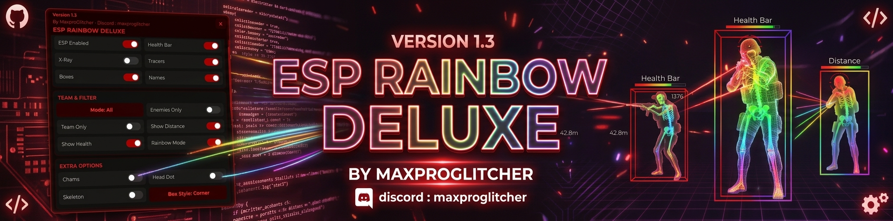

# ESP-Raimbow-Back-Up-
This script is the brand-new version of the project a complete rewrite that's way better, haha👀

 # Loadstring Script 
```lua
loadstring(game:HttpGet("https://raw.githubusercontent.com/MaxproGlitcher/ESP-Raimbow-Back-Up-/refs/heads/main/Code-OpenSource/Loadstring.luau"))()
```


